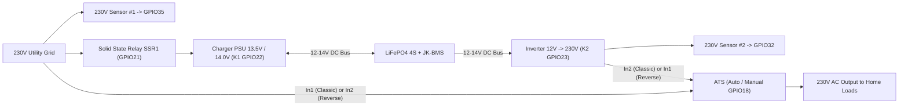

# 🔋 Online Grid LFP 3.6 — Smart Double-Conversion UPS & Power Station (ESPHome + JK-BMS)

**[🇬🇧 English Documentation (Primary)](#-english-documentation) | [🇺🇦 Документація українською (Нижче)](#-документація-українською)**

---

# 🇬🇧 English Documentation

A DIY high-power Uninterruptible Power Supply (UPS) and energy storage station based on a **LiFePO4 4S (12.8V) battery**, **JK-BMS (Bluetooth)**, and an **ESP32 microcontroller**, with full **Home Assistant (ESPHome)** integration.

This guide is written specifically so that someone with **beginner-level electronics knowledge** can understand, wire, and configure the entire station safely.

---

## 💡 How Does It Work in Simple Terms?

Unlike standard offline inverters or basic computer UPS units, this station supports two main operating modes:

1. **ONLINE Mode (Double Conversion — `230V AC → 13.5V/14.0V DC → 230V AC`):**
   * Your home appliances are continuously powered by the clean pure-sine-wave output of the **inverter** (`12V DC → 230V AC`), completely isolating them from grid voltage spikes, brownouts, or noise.
   * Meanwhile, a high-power **DC power supply / charger** (`230V AC → 13.5V DC`) continuously powers the inverter and keeps the LiFePO4 battery in a safe **float/buffer state (`13.5V`)** where the battery neither overcharges nor degrades.
   * When the battery needs charging (`SOC < Min SOC to Charge`), the ESP32 switches the power supply to **`14.0V (bulk charge)`**, charges the battery to `100%`, waits **15 minutes** while the cells balance within `< 0.01V` (`10 mV`), and then switches back to **`13.5V (float)`**.
   * When a grid blackout occurs, the **transfer time is 0 ms** because your appliances were already running from the inverter!

2. **BYPASS / OFFLINE Mode (Energy-Saving Grid Bypass):**
   * While the utility grid is stable, the **Automatic Transfer Switch (ATS / АВР)** feeds your home directly from the 230V grid.
   * As soon as the grid fails, the station automatically switches to battery power via the inverter, and switches back to the grid once utility power returns.

All switching delays, button indicators, cooling fans, and multi-stage protections are controlled autonomously by the **ESP32** (it continues working 100% autonomously even without Wi-Fi or Home Assistant).

---

## 🛠️ Bill of Materials (Required Components)

### 1. Power Electronics:
1. **LiFePO4 4S Battery Pack (12.8V, 100–350 Ah)** — 4 LiFePO4 cells connected in series.
2. **Smart JK-BMS with Bluetooth & Active Balancer** (`JK02_32S` protocol family, e.g., `JK-B1A8S20P` or `JK-B2A8S20P` 200A).
3. **High-Power PSU / Charger 230V AC → 12–15V DC (50–100A)**:
   * E.g., a modified server PSU or high-current switching power supply with a voltage adjustment trimmer potentiometer (`V-ADJ`).
   * *Dual-voltage modification (`13.5V / 14.0V`):* a fixed resistor is connected through the contacts of **Relay K1** to the center pin (wiper) of the voltage adjustment potentiometer (resistance value is selected experimentally — see instructions below).
4. **Pure Sine Wave Inverter Module 12V DC → 230V AC (1–2 kW)**:
   * The inverter's power switch wires are connected to the contacts of **Relay K2**.
5. **230V AC Automatic Transfer Switch (ATS / АВР, 2-Pole, 63A)**:
   * Motorized or fast-switching ATS with an **Auto / Manual** mode selector and an external control input to force `Manual` mode (locks the ATS in its current position).
6. **Solid State Relay `SSR1` (e.g., `SSR-40DA` or `SSR-60DA`) + Heatsink**:
   * Control input: `3–32V DC` (controlled by `GPIO21`).
   * Load output: `24–380V AC` (switches 230V AC power to the charger PSU).

### 2. Control Electronics & Sensors:
7. **ESP32 Development Board** (**Wemos D1 Mini32** or standard 30-pin ESP32 DevKit).
8. **2-Channel 5V Relay Module (Opto-isolated, Active `LOW` trigger)**:
   * **Relay K1** (`GPIO22`) — switches charger voltage between `13.5V (float)` and `14.0V (bulk)`.
   * **Relay K2** (`GPIO23`) — turns the 230V inverter ON/OFF.
9. **230V AC to 3.3V DC Optocoupler Voltage Detection Modules — 2 pcs**:
   * 1-channel AC detection boards (230V AC screw terminals on input; `VCC`, `GND`, `OUT` pins on output; outputs `LOW / 0V` when 230V AC is present).
   * Module #1 monitors **230V Utility Grid** (`GPIO35`); Module #2 monitors **230V Inverter Output** (`GPIO32`).
10. **4-Channel Optocoupler Isolation Board (e.g., PC817) or Transistor Driver Array**:
    * Isolates physical panel switches (`SW2–SW4`) and drives button LEDs (`LED 1–LED 4`) + ATS `Manual` mode coil.
11. **Latching Push-Button Switches with Built-in LED Illumination — 4 pcs**:
    * **SW1 (`Power`)** — main control power button (with power latch).
    * **SW2 (`Online / Bypass`)** — operating mode selector.
    * **SW3 (`Charger`)** — charger automation enable switch.
    * **SW4 (`Inverter`)** — inverter automation enable switch.
12. **Step-Down DC-DC Buck Converter `12–15V DC → 5V DC` (min. 2–3A)**:
    * Powers the ESP32 and 5V relay module from the 12V battery bus.
    * Wired with a **self-latching power circuit**: pressing `SW1` powers up the DC-DC converter, and within milliseconds of booting, ESP32 sets `GPIO19` HIGH to hold the DC-DC enabled. If battery SOC drops below the critical threshold (`6%`) with no grid present, ESP32 sets `GPIO19` LOW to completely shut down the station and prevent battery damage.
13. **Waterproof Digital Temperature Sensors `DS18B20` — 2 pcs** + **`4.7 kΩ` Pull-Up Resistor**:
    * Mounted on the charger heatsink (`temperature_charger`) and inverter heatsink (`temperature_invertor`).
14. **12V DC 4-Pin PWM Cooling Fans** (1–2 pcs):
    * Controlled via a 20 kHz PWM signal from `GPIO27`.
15. **Safety & Wiring Hardware (Mandatory!):**
    * Main DC Battery Fuse (`150A–250A` ANL or MEGA fuse) installed as close as possible to the battery positive (`+`) terminal.
    * Input and output 230V AC circuit breakers (`10A–16A`).
    * Heavy-duty copper cables (`25–35 mm²`) with crimped lugs for the 12V DC bus.

---

## 🔌 Wiring Guide (Step-by-Step for Beginners)

### 1. 230V AC Power Topology & Two ATS Wiring Options

This repository includes two firmware configurations depending on how you wire the two inputs of your Automatic Transfer Switch (ATS):

#### Option A: Classic ATS Wiring ([`online_grid_device.yaml`](online_grid_device.yaml))
* **ATS Input 1 (Primary / Priority):** connected to **230V Utility Grid**.
* **ATS Input 2 (Backup):** connected to **230V Inverter Output**.
* **Charger PSU 230V Input:** connected to the **Utility Grid BEFORE the ATS** via **SSR1** (so the charger never powers itself from the inverter!).

#### Option B: Reverse ATS Wiring ([`online_grid_device_reverse_AVR.yaml`](online_grid_device_reverse_AVR.yaml))
* **ATS Input 1 (Primary / Priority):** connected to **230V Inverter Output**.
* **ATS Input 2 (Backup):** connected to **230V Utility Grid**.
* *Advantage of Option B:* In **Bypass Mode** (`SW2` ON) while grid power is present, the inverter is completely turned OFF (zero idle battery drain!), and the charger only turns ON when the battery actually needs charging (`SOC < Min SOC to Charge`), turning `SSR1` completely OFF after reaching 100%. Switching to **Online Mode** (`SW2` OFF) transfers the load to the inverter immediately without waiting for a grid outage.

---

### 2. How to Modify the Power Supply for Dual Voltage (`13.5V` / `14.0V`) Using Relay K1

1. Locate the voltage adjustment trimmer potentiometer (`V-ADJ` / `VR1`) on your power supply board.
2. With **Relay K1 open (OFF)**, adjust the potentiometer so the PSU outputs exactly **`13.5V`** (`3.375V` per cell — safe float voltage for 4S LiFePO4).
3. Connect a fixed resistor in series with the **Normally Open (`NO` and `COM`) contacts of Relay K1** between the **center pin (wiper)** of the potentiometer and the outer pin that raises the output voltage.
4. Experimentally select the resistor value (start with a higher resistance such as `50–100 kΩ` or use a multi-turn trimmer to find the exact value, then replace with a fixed resistor) so that when **Relay K1 closes (ON)**, the PSU voltage rises from `13.5V` to **`14.0V–14.1V`**.

---

### 3. Complete ESP32 Pinout Table

> **Important for beginners:** ESP32 GPIO pins use **`3.3V` logic**. Never apply `5V` or `12V` directly to any ESP32 pin! Connect all low-voltage grounds (`GND` of ESP32, 5V DC-DC converter, relay board, and sensors) together.

| ESP32 Pin | Component / Function | Active Level | Physical Wiring Instructions |
| :--- | :--- | :--- | :--- |
| **`5V` (VCC)** | `+5V` from DC-DC Buck Converter | `5V DC` Power | Connect to ESP32 `5V`/`VIN` pin and 2-channel relay module `VCC` |
| **`GND`** | Common Ground | `0V` | Connect to `GND` of DC-DC converter, relay module, optocouplers, and sensors |
| **`GPIO36`** | **SW2** Switch (`online_sw`) | Active `LOW` (pulls to `GND`) | Output of SW2 optocoupler (pull up to `3.3V` with a `4.7–10 kΩ` resistor; closes to `GND` when SW2 is ON) |
| **`GPIO39`** | **SW3** Switch (`charger_sw`) | Active `LOW` (pulls to `GND`) | Output of SW3 optocoupler (pull up to `3.3V` with `4.7–10 kΩ`; closes to `GND` when SW3 is ON) |
| **`GPIO34`** | **SW4** Switch (`invertor_sw`) | Active `LOW` (pulls to `GND`) | Output of SW4 optocoupler (pull up to `3.3V` with `4.7–10 kΩ`; closes to `GND` when SW4 is ON) |
| **`GPIO35`** | **230V Grid** Sensor (`grid_230v`) | Active `LOW` (230V present = `0V`) | `OUT` pin of 230V AC Optocoupler Module #1 (power the module's low-voltage side from **`3.3V`** and **`GND`**!) |
| **`GPIO32`** | **230V Inverter** Sensor (`inverter_230v`) | Active `LOW` (230V present = `0V`) | `OUT` pin of 230V AC Optocoupler Module #2 (power from **`3.3V`** and **`GND`**!) |
| **`GPIO19`** | **LED 1** (`led_power_sw`) + Power Latch | Active `HIGH` (`3.3V`) | Drives SW1 Power Button LED + latches the 5V DC-DC converter ON |
| **`GPIO18`** | **LED 2** (`led_online_sw`) + ATS Manual Mode | Active `HIGH` (`3.3V`) | Drives SW2 Button LED + switches the ATS into **Manual** mode |
| **`GPIO17`** | **LED 3** (`led_charger_sw`) | Active `HIGH` (`3.3V`) | Drives SW3 Charger Button LED |
| **`GPIO16`** | **LED 4** (`led_invertor_sw`) | Active `HIGH` (`3.3V`) | Drives SW4 Inverter Button LED |
| **`GPIO21`** | **SSR1** Control (`ssr1`) | Active `HIGH` (`3.3V`) | Positive control terminal `+DC` of Solid State Relay **SSR1** (`-DC` goes to `GND`) |
| **`GPIO22`** | **Relay K1** (`chrg_voltage`) | Active `LOW` (`0V` = Relay ON) | `IN1` of 2-channel relay module (`OFF` = `13.5V(float)`, `ON` = `14V(bulk)`) |
| **`GPIO23`** | **Relay K2** (`invertor_relay`) | Active `LOW` (`0V` = Relay ON) | `IN2` of 2-channel relay module (`COM` and `NO` contacts close the inverter power switch) |
| **`GPIO33`** | **DS18B20** Temp Sensors (2 pcs) | 1-Wire Digital Bus | Connect both yellow/data wires to `GPIO33`. **Add a `4.7 kΩ` resistor between `GPIO33` and `3.3V`!** Red wires → `3.3V`, Black wires → `GND` |
| **`GPIO27`** | **Cooling Fans PWM** (`pwm_fans_out`) | 20 kHz PWM | Connect to the blue PWM control wire (Pin 4) of the 12V cooling fans |

> **Note on `GPIO34`, `GPIO35`, `GPIO36`, `GPIO39`:** These four pins on the ESP32 are input-only and **do not have internal pull-up resistors**. Make sure your optocoupler outputs have a `4.7 kΩ – 10 kΩ` pull-up resistor to `3.3V`.

---

## 🚀 Quick Start & Flashing Guide

1. Copy either [`online_grid_device.yaml`](online_grid_device.yaml) (Classic ATS) or [`online_grid_device_reverse_AVR.yaml`](online_grid_device_reverse_AVR.yaml) (Reverse ATS) into your ESPHome directory (`/config/esphome/`).
2. Copy [`secrets.yaml.example`](secrets.yaml.example) to **`secrets.yaml`** and enter your Wi-Fi credentials, API key, and JK-BMS Bluetooth MAC address.
3. **How to find your DS18B20 sensor addresses:**
   * Flash the ESP32 once with the placeholder addresses (`0x0000000000000028`) and open the **ESPHome Logs**.
   * Copy the two `0x...` addresses printed under `Found sensors:` into your `secrets.yaml` and re-install wirelessly (OTA).

---

## 🛡️ Button LEDs & Built-In Safety Protections

* **LED 1 (`SW1 Power`):** Solid ON while powered. Turns OFF only to shut down the station on critical battery depletion (`SOC < 6%`).
* **LED 2 (`SW2 Mode`):** Solid ON when ATS Manual Lock (`GPIO18`) is active.
* **LED 3 (`SW3 Charger`):**
  * **Solid ON:** Charger PSU is powered (`SSR1` ON).
  * **Blinks 1s ON / 1s OFF:** Charger switch is ON, waiting for 230V grid at startup.
  * **Blinks 1s ON / 3s OFF:** 230V grid was lost during operation.
  * **Blinks 2s ON / 2s OFF:** 230V grid restored — **1-minute stabilization countdown** before turning on `SSR1`.
* **LED 4 (`SW4 Inverter`):**
  * **Solid ON:** Inverter is running normally (230V output verified).
  * **Blinks 1s ON / 1s OFF:** Inverter starting up (5s check) or waiting after failed start.
  * **Fast Blink (0.5s ON / 0.5s OFF):** Inverter fault (`Inverter Output Lost!` or `Discharge Overload! > 120A`).
* **Alternating Blink `LED 3 ↔ LED 4` (0.5s):** Critical overheat (`> 75°C`) OR **BMS Error Lockout** (BMS Bluetooth offline `> 15s`, BMS charge cutoff, or BMS discharge cutoff).
  * *Note:* BMS Error Lockout is saved in flash memory across reboots. Clear it in Home Assistant using the **`Reset BMS Lockout`** button after inspecting the battery.

---
---

# 🇺🇦 Документація українською

Проєкт саморобного потужного джерела безперебійного живлення (ДБЖ / UPS) на базі акумулятора **LiFePO4 4S (12.8В)**, розумної плати **JK-BMS (Bluetooth)** та мікроконтролера **ESP32** з повною інтеграцією в **Home Assistant (ESPHome)**.

Опис та документація складені спеціально так, щоб зібрати та налаштувати станцію змогла людина з **початковими знаннями в електроніці**.

---

## 💡 Як це працює простими словами?

Станція вміє працювати у двох основних режимах:

1. **Режим ОНЛАЙН (Подвійне перетворення енергії — `230В → 13.5/14В → 230В`):**
   * Ваші домашні прилади живляться від чистої синусоїди **інвертора** (`12В → 230В`), якому абсолютно байдуже на стрибки напруги в розетці.
   * Енергію для інвертора постійно постачає потужний **блок живлення / зарядка** (`230В → 13.5В`), підтримуючи акумулятор у безпечному **буферному режимі (`13.5 В`)**, де батарея не перезаряджається і не зношується.
   * Коли акумулятор потрібно зарядити (`SOC < Min SOC to Charge`) — контролер автоматично перемикає блок живлення на напругу **`14.0 В`**, заряджає батарею до `100%`, чекає **15 хвилин** поки комірки ідеально вирівняються (відбалансуються до різниці менше `0.01 В`), і знову повертає блок живлення на безпечні **`13.5 В`**.
   * Якщо світло в міській мережі зникає — **перемикання становить 0 мілісекунд**, бо прилади вже працювали від інвертора!

2. **Режим БАЙПАС / ОФЛАЙН (Економний режим обходу):**
   * Коли в розетці стабільна напруга, автоматичний перемикач вводу резерву (**АВР**) пропускає міську мережу 230В напряму у ваш дім.
   * Щойно світло зникає — станція автоматично переходить на живлення від акумулятора через інвертор, а після повернення світла — повертається на мережу і за потреби дозаряджає акумулятор.

---

## 🛠️ Необхідні компоненти для збірки (Список деталей)

### 1. Силова частина:
1. **Акумуляторна збірка LiFePO4 4S (12.8В, ємність 100–350 А·год)** — 4 послідовно з'єднані комірки LiFePO4.
2. **Плата захисту JK-BMS з Bluetooth та активним балансиром** (протокол `JK02_32S`, наприклад `JK-B1A8S20P` або `JK-B2A8S20P` на 200А).
3. **Потужний блок живлення / зарядний пристрій 230В → 12–15В (на 50–100 Ампер)**:
   * Модернізований під зміну напруги (`13.5В / 14.0В`) додаванням постійного резистора через контакти реле **К1** до середнього контакту регулюючого напругу потенціометра (опір підбирається експериментально).
4. **Модуль інвертора чистої синусоїди 12В → 230В (1–2 кВт)** (кнопка запуску виведена на контакти реле **К2**).
5. **АВР (Автоматичне введення резерву) 230В, 2 полюси (2P, 63A)** із режимами **Auto / Manual** та зовнішнім входом переведення в ручний режим.
6. **Твердотільне реле `SSR1` (`SSR-40DA` або `SSR-60DA`) + радіатор** (вмикає 230В на зарядний блок живлення).

### 2. Електроніка керування та датчики:
7. **Плата мікроконтролера ESP32** (**Wemos D1 Mini32** або ESP32 DevKit 30-pin).
8. **Модуль на 2 реле (5В, з опторозв'язкою, активний рівень `LOW`)** — реле **К1** (13.5В/14В) та **К2** (інвертор).
9. **Модулі гальванічної розв'язки 230В AC → 3.3В DC — 2 шт.** (контроль мережі 230В та виходу інвертора 230В).
10. **Плата опторозв'язки (PC817 на 4 канали) або транзисторні ключі** для кнопок, світлодіодів та керування АВР.
11. **Кнопки з фіксацією та LED-підсвіткою — 4 шт.** (`SW1 Power`, `SW2 Online/Bypass`, `SW3 Charger`, `SW4 Inverter`).
12. **Понижуючий DC-DC перетворювач `12–15В → 5В` (2–3А)** зі схемою самопідхвату живлення від `GPIO19`.
13. **Цифрові датчики температури `DS18B20` — 2 шт.** + **резистор `4.7 кОм`**.
14. **Корпусні 4-контактні PWM-вентилятори 12В**.
15. **Силовий запобіжник DC (`150–250А`), автомати AC 230В (`10–16А`), силові дроти `25–35 мм²`**.

---

## 🔌 Схема підключення та таблиця контактів ESP32

### Два варіанти підключення входів АВР:
* **Варіант А — Класичний ([`online_grid_device.yaml`](online_grid_device.yaml)):**
  * **Вхід 1 АВР (Основний):** Міська мережа 230В.
  * **Вхід 2 АВР (Резервний):** Вихід інвертора 230В.
  * Кнопка `SW2` (`online_sw`) вмикає режим **Онлайн** (після першого зникнення світла `GPIO18` фіксує АВР на інверторі).
* **Варіант Б — Реверсний ([`online_grid_device_reverse_AVR.yaml`](online_grid_device_reverse_AVR.yaml)):**
  * **Вхід 1 АВР (Основний):** Вихід інвертора 230В.
  * **Вхід 2 АВР (Резервний):** Міська мережа 230В.
  * Кнопка `SW2` (`online_sw`) вмикає економний режим **Байпас**: коли є мережа, інвертор та LED 4 вимкнені, АВР зафіксований на мережі (`GPIO18` ON, світиться LED 2), а зарядка (`SSR1` + `14V` + LED 3) вмикається тільки при `SOC < Min SOC to Charge` і повністю вимикається після заряду.

### Таблиця контактів ESP32:
* **`GPIO36`** — Вхід кнопки **SW2** (`online_sw`, активний `LOW`, потрібна підтяжка `4.7–10 кОм` до `3.3V`).
* **`GPIO39`** — Вхід кнопки **SW3** (`charger_sw`, активний `LOW`, підтяжка `4.7–10 кОм` до `3.3V`).
* **`GPIO34`** — Вхід кнопки **SW4** (`invertor_sw`, активний `LOW`, підтяжка `4.7–10 кОм` до `3.3V`).
* **`GPIO35`** — Вхід датчика **230В Мережа** (`grid_230v`, активний `LOW`, підтяжка `4.7–10 кОм` до `3.3V`).
* **`GPIO32`** — Вхід датчика **230В Інвертор** (`inverter_230v`, активний `LOW`).
* **`GPIO19`** — Вихід **LED 1** (`led_power_sw`) + самопідхват DC-DC 5В живлення (активний `HIGH`).
* **`GPIO18`** — Вихід **LED 2** (`led_online_sw`) + переведення АВР у ручний режим `Manual` (активний `HIGH`).
* **`GPIO17`** — Вихід **LED 3** (`led_charger_sw`, підсвітка кнопки зарядки, активний `HIGH`).
* **`GPIO16`** — Вихід **LED 4** (`led_invertor_sw`, підсвітка кнопки інвертора, активний `HIGH`).
* **`GPIO21`** — Вихід керування твердотільним реле **SSR1** (`ssr1`, подача 230В на БЖ, активний `HIGH`).
* **`GPIO22`** — Вихід **Реле К1** (`chrg_voltage`, активний `LOW`: `OFF` = `13.5V(float)`, `ON` = `14V(bulk)`).
* **`GPIO23`** — Вихід **Реле К2** (`invertor_relay`, активний `LOW`: увімкнення інвертора).
* **`GPIO33`** — Шина 1-Wire датчиків **DS18B20** (обов'язковий резистор **`4.7 кОм`** між `GPIO33` та `3.3V`).
* **`GPIO27`** — Вихід **PWM 20 кГц** (`pwm_fans_out`) на 4-й синій провід корпусних вентиляторів.

---

## 📂 Файли проєкту / Repository Files

* [`online_grid_device.yaml`](online_grid_device.yaml) — Classic ATS firmware / Прошивка для класичного підключення АВР.
* [`online_grid_device_reverse_AVR.yaml`](online_grid_device_reverse_AVR.yaml) — Reverse ATS firmware / Прошивка для реверсного підключення АВР.
* [`secrets.yaml.example`](secrets.yaml.example) — Secrets template / Шаблон файлу секретів.
* [`home_assistant/ha_dashboard.yaml`](home_assistant/ha_dashboard.yaml) — Bilingual Home Assistant Dashboard / Двомовна панель керування HA.
* [`home_assistant/ha_automation_charger_overvoltage.yaml`](home_assistant/ha_automation_charger_overvoltage.yaml) — Grid overvoltage protection automation / Автоматизація захисту від перенапруги.
