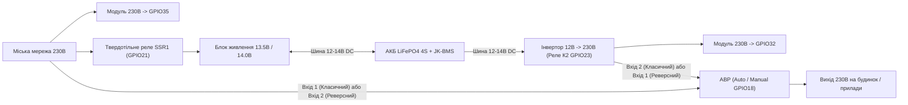

# 🔋 Online Grid LFP 3.6 — Розумна зарядна станція та ДБЖ подвійного перетворення (ESPHome + JK-BMS)

Проєкт саморобного потужного джерела безперебійного живлення (ДБЖ / UPS) на базі акумулятора **LiFePO4 4S (12.8В)**, розумної плати **JK-BMS (Bluetooth)** та мікроконтролера **ESP32** з повною інтеграцією в **Home Assistant (ESPHome)**.

Опис та документація складені спеціально так, щоб зібрати та налаштувати станцію змогла людина з **початковими знаннями в електроніці**.

---

## 💡 Як це працює простими словами?

На відміну від звичайних комп'ютерних безперебійників або простих інверторів, ця станція вміє працювати у двох основних режимах:

1. **Режим ОНЛАЙН (Подвійне перетворення енергії — `230В → 13.5/14В → 230В`):**
   * Ваші домашні прилади живляться від чистої синусоїди **інвертора** (`12В → 230В`), якому абсолютно байдуже на стрибки напруги в розетці.
   * А енергію для інвертора постійно постачає потужний **блок живлення / зарядка** (`230В → 13.5В`), підтримуючи акумулятор у так званому **буферному режимі (`13.5 В`)**, де батарея не перезаряджається і не зношується.
   * Коли акумулятор потрібно зарядити — контролер автоматично перемикає блок живлення на напругу **`14.0 В`**, заряджає батарею до `100%`, чекає 15 хвилин поки комірки ідеально вирівняються (відбалансуються до різниці менше `0.01 В`), і знову повертає блок живлення на безпечні **`13.5 В`**.
   * Якщо світло в міській мережі зникає — **перемикання становить 0 мілісекунд**, бо прилади вже працювали від інвертора!

2. **Режим БАЙПАС / ОФЛАЙН (Економний режим обходу):**
   * Коли в розетці стабільна напруга, автоматичний перемикач вводу резерву (**АВР**) пропускає міську мережу 230В напряму у ваш дім.
   * Щойно світло зникає — станція автоматично переходить на живлення від акумулятора через інвертор, а після повернення світла — повертається на мережу і за потреби дозаряджає акумулятор.

Усіма процесами, плавним запуском, затримками, охолодженням корпусу та багаторівневим захистом керує плата **ESP32**, яка спілкується з батареєю (**JK-BMS**) по Bluetooth і працює **повністю автономно** (навіть без інтернету, Wi-Fi чи роутера).

---

## 🛠️ Необхідні компоненти для збірки (Список деталей)

### 1. Силова частина:
1. **Акумуляторна збірка LiFePO4 4S (12.8В, ємність 100–350 А·год)** — 4 послідовно з'єднані комірки LiFePO4.
2. **Плата захисту JK-BMS з Bluetooth та активним балансиром** (серія з протоколом `JK02_32S`, наприклад `JK-B1A8S20P` або `JK-B2A8S20P` на 200А).
3. **Потужний блок живлення / зарядний пристрій 230В → 12–15В (на 50–100 Ампер)**:
   * Наприклад, серверний блок живлення або потужний лабораторний/промисловий БЖ з підлаштувальним резистором (потенціометром) регулювання вихідної напруги.
   * *Модернізація під 2 напруги (`13.5В / 14.0В`):* через контакти реле **К1** підключається додатковий постійний резистор до середнього виводу потенціометра регулювання напруги (детальна схема нижче).
4. **Модуль інвертора чистої синусоїди 12В → 230В (потужність 1–2 кВт)**:
   * Кнопка вмикання інвертора виводиться двома проводами на контакти реле **К2**.
5. **АВР (Автоматичне введення резерву) 230В, 2 полюси (2P, 63A)**:
   * Моторний або швидкодіючий АВР із перемикачем режимів **Auto / Manual** (Автоматичний / Ручний) та контактами для зовнішнього переведення в ручний режим.
6. **Твердотільне реле (SSR — Solid State Relay) `SSR1` (наприклад, `SSR-40DA` або `SSR-60DA`) + радіатор**:
   * Вхід керування: `3–32V DC` (вмикається напряму або через ключ від ESP32).
   * Вихід комутації: `24–380V AC` (вмикає подачу 230В на блок живлення зарядки).

### 2. Електроніка керування та датчики:
7. **Плата мікроконтролера ESP32** (у проєкті використано **Wemos D1 Mini32** або будь-яку плату ESP32 DevKit 30-pin).
8. **Модуль на 2 електромагнітні реле (5В, з опторозв'язкою, активний низький рівень `LOW Trigger`)**:
   * **Реле К1** — перемикає напругу зарядки `13.5В ↔ 14.0В`.
   * **Реле К2** — вмикає та вимикає інвертор.
9. **Модулі гальванічної розв'язки контролю наявності 230В AC → 3.3В DC — 2 шт.**:
   * Готові плати опторозв'язки на 1 канал (на вході клемник 230В AC, на виході `VCC`, `GND`, `OUT`). Коли на вході є 230В — на виході `OUT` з'являється низький рівень `LOW` (0В).
   * Один модуль підключається до вхідної міської мережі 230В, другий — до виходу 230В інвертора.
10. **Плата опторозв'язки (наприклад, 4-канальний модуль на PC817) або транзисторні ключі**:
    * Для безпечного підключення кнопок керування (`SW2`, `SW3`, `SW4`) до входів ESP32 та керування світлодіодами підсвітки кнопок (`LED 1–LED 4`) і входом `Manual` АВР.
11. **Кнопки на передню панель з фіксацією та вбудованою LED-підсвіткою — 4 шт.**:
    * **SW1 (`Power`)** — головне живлення керування (з самопідхватом).
    * **SW2 (`Online / Bypass`)** — вибір режиму роботи станції.
    * **SW3 (`Charger`)** — увімкнення автоматики зарядного пристрою.
    * **SW4 (`Inverter`)** — увімкнення автоматики інвертора.
12. **Понижуючий перетворювач напруги DC-DC (Step-Down) `12–15В → 5В` (мінімум 2–3А)**:
    * Живить плату ESP32 та 2-канальний модуль реле від акумулятора 12В.
    * Оснащений схемою **самопідхвату живлення** (при натисканні кнопки `SW1` подається 5В на ESP32, а ESP32 у першу мілісекунду старту подає сигнал `3.3В` з ніжки `GPIO19` через оптопару/транзистор, утримуючи DC-DC увімкненим; якщо акумулятор сяде нижче критичних 6% і немає світла — ESP32 зніме сигнал з `GPIO19` і повністю знеструмить себе, щоб не вбити батарею!).
13. **Цифрові датчики температури `DS18B20` (у металевій гільзі на проводі) — 2 шт.** + **резистор `4.7 кОм` (0.25 Вт)**:
    * Один датчик кріпиться до радіатора блока живлення (зарядки), другий — до радіатора інвертора.
14. **Корпусні вентилятори охолодження 12В з 4-контактним ШІМ (PWM) входом** (1–2 шт.):
    * Підключаються до шини 12В, а їхній синій PWM-провід керується з виходу `GPIO27` ESP32.
15. **Захисна автоматика та монтаж (обов'язково для безпеки!):**
    * Силовий запобіжник постійного струму (DC Fuse `150A–250A` типу ANL або MEGA) максимально близько до плюсової клеми акумулятора.
    * Вхідний та вихідний автоматичні вимикачі змінного струму 230В (`10A–16A`).
    * Силовий мідний кабель перерізом `25–35 мм²` з обтиснутими наконечниками для підключення АКБ, БЖ та інвертора.

---

## 🔌 Схема підключення (Детальний опис для початківців)

### 1. Силова схема змінного струму 230В (AC) та два варіанти підключення АВР

У проєкті є дві готові прошивки — виберіть ту, яка відповідає вашому підключенню входів АВР:

#### Варіант А: Класичне підключення АВР (файл [`online_grid_device.yaml`](online_grid_device.yaml))
* **Вхід 1 АВР (Основний / Пріоритетний):** підключається **Міська мережа 230В**.
* **Вхід 2 АВР (Резервний):** підключається **Вихід інвертора 230В**.
* **Зарядний БЖ 230В:** підключається до вхідної міської мережі **до АВР** через твердотільне реле **SSR1** (щоб зарядка ніколи не живила сама себе від інвертора!).
* **Датчик 230В Мережі (`GPIO35`):** підключається до вхідної мережі 230В (до АВР).
* **Датчик 230В Інвертора (`GPIO32`):** підключається до виходу 230В інвертора (до АВР).

#### Варіант Б: Реверсне підключення АВР (файл [`online_grid_device_reverse_AVR.yaml`](online_grid_device_reverse_AVR.yaml))
* **Вхід 1 АВР (Основний / Пріоритетний):** підключається **Вихід інвертора 230В**.
* **Вхід 2 АВР (Резервний):** підключається **Міська мережа 230В**.
* *Перевага цього варіанту:* в режимі «Байпас» (`SW2` увімкнено) за наявності міської мережі інвертор повністю вимкнений (не садить батарею на холостому ходу), а зарядка вмикається лише тоді, коли батарея розряджена, і повністю вимикається після досягнення 100%. А при переході в «Онлайн» (`SW2` вимкнено) станція миттєво переходить на інвертор без очікування зникнення світла.



---

### 2. Як модернізувати блок живлення під дві напруги (`13.5 В` та `14.0 В`) через реле К1

1. Знайдіть на платі вашого блока живлення штатний підлаштувальний резистор (потенціометр) регулювання вихідної напруги (зазвичай підписаний `V-ADJ` або `VR1`).
2. При **розімкненому** реле **К1** виставте цим потенціометром на виході блока живлення рівно **`13.5 В`** (це безпечна буферна напруга для LiFePO4 4S — по `3.375 В` на комірку).
3. Візьміть постійний резистор і підключіть його **послідовно з нормально розімкненими контактами (`NO` та `COM`) реле К1** між середнім виводом потенціометра та відповідним крайнім виводом (`GND` або виходом дільника — залежно від схеми БЖ, щоб підключення резистора **підвищувало** вихідну напругу).
4. Експериментально підберіть опір цього резистора (почніть з більшого опору, наприклад `50–100 кОм`, поступово зменшуючи або використовуючи тимчасовий багатообертовий резистор) так, щоб при **замиканні реле К1** напруга блока живлення піднімалася з `13.5 В` до **`14.0–14.1 В`**.

---

### 3. Повна таблиця підключення контактів ESP32 (Pinout)

> **Важливо для початківців:** Плата ESP32 працює з логічною напругою **`3.3 В`**. Ніколи не подавайте на її ніжки `5 В` або `12 В` напряму — використовуйте оптопари або узгоджувачі рівнів! Усі землі (`GND`) низьковольтної частини (ESP32, модуль реле 5В, DC-DC 5В, датчики DS18B20) мають бути з'єднані між собою.

| Ніжка ESP32 | Що підключається | Як працює рівень сигналу | Куди фізично під'єднати провід |
| :--- | :--- | :--- | :--- |
| **`5V` (VCC)** | Вихід `+5V` з DC-DC перетворювача | Живлення `5 В` | На ніжку `5V` (`VCC`/`VIN`) плати ESP32 та `VCC` модуля реле |
| **`GND`** | Загальний мінус (`GND`) | `0 В` | З'єднати з `GND` DC-DC перетворювача, модуля реле, датчиків та оптопар |
| **`GPIO36`** | Кнопка **SW2** (`online_sw`) | Активний `LOW` (замикання на `GND`) | Вихід оптопари кнопки **SW2** (підтягнутий до `3.3V` через резистор `10 кОм`, при натисканні SW2 замикається на `GND`) |
| **`GPIO39`** | Кнопка **SW3** (`charger_sw`) | Активний `LOW` (замикання на `GND`) | Вихід оптопари кнопки **SW3** (аналогічно SW2: підтяжка `10 кОм` до `3.3V`, при увімкненні замикає на `GND`) |
| **`GPIO34`** | Кнопка **SW4** (`invertor_sw`) | Активний `LOW` (замикання на `GND`) | Вихід оптопари кнопки **SW4** (аналогічно SW2: підтяжка `10 кОм` до `3.3V`, при увімкненні замикає на `GND`) |
| **`GPIO35`** | Датчик **230В Мережа** (`grid_230v`) | Активний `LOW` (є 230В = `0 В`) | Вихід `OUT` першого модуля гальванічної розв'язки 230В (живлення низьковольтної частини модуля — від **`3.3V`** та **`GND`** ESP32!) |
| **`GPIO32`** | Датчик **230В Інвертор** (`inverter_230v`) | Активний `LOW` (є 230В = `0 В`) | Вихід `OUT` другого модуля гальванічної розв'язки 230В (живлення модуля — від **`3.3V`** та **`GND`** ESP32!) |
| **`GPIO19`** | **LED 1** (`led_power_sw`) + Самопідхват живлення | Активний `HIGH` (`3.3 В`) | На вхід оптопари/ключа, який засвічує підсвітку кнопки живлення **SW1** і утримує увімкненим DC-DC перетворювач 5В |
| **`GPIO18`** | **LED 2** (`led_online_sw`) + Ручний режим АВР | Активний `HIGH` (`3.3 В`) | На вхід оптопари/реле, яке одночасно засвічує підсвітку кнопки **SW2** і подає сигнал переходу АВР у режим **Manual** |
| **`GPIO17`** | **LED 3** (`led_charger_sw`) | Активний `HIGH` (`3.3 В`) | На вхід оптопари/ключа підсвітки кнопки зарядки **SW3** |
| **`GPIO16`** | **LED 4** (`led_invertor_sw`) | Активний `HIGH` (`3.3 В`) | На вхід оптопари/ключа підсвітки кнопки інвертора **SW4** |
| **`GPIO21`** | Твердотільне реле **SSR1** (`ssr1`) | Активний `HIGH` (`3.3 В`) | На плюсовий вхід керування `+DC` твердотільного реле **SSR1** (або через транзисторний ключ/оптопару), мінус `-DC` реле — на `GND` |
| **`GPIO22`** | **Реле К1** (`chrg_voltage` 13.5В/14В) | Активний `LOW` (`0 В` вмикає реле) | На вхід `IN1` двоканального модуля реле. Контакти реле `COM` і `NO` вмикають додатковий резистор на БЖ (14В) |
| **`GPIO23`** | **Реле К2** (`invertor_relay`) | Активний `LOW` (`0 В` вмикає реле) | На вхід `IN2` двоканального модуля реле. Контакти реле `COM` і `NO` замикають кнопку живлення інвертора |
| **`GPIO33`** | Датчики температури **DS18B20** (2 шт.) | Цифрова шина 1-Wire | Жовті (сигнальні `DATA`) проводи обох датчиків DS18B20 разом. **Обов'язково** припаяйте резистор **`4.7 кОм`** між `GPIO33` та ніжкою **`3.3V`**! Червоні проводи датчиків — на `3.3V`, чорні — на `GND` |
| **`GPIO27`** | ШІМ керування вентиляторами (`pwm_fans_out`) | PWM сигнал `20 кГц` | На синій (4-й) провід PWM вентиляторів (або на вхід MOSFET-модуля ШІМ, якщо вентилятори 2-проводні) |

> **Примітка щодо підтягуючих резисторів на `GPIO34`, `GPIO36`, `GPIO39`, `GPIO35`: **
> У мікроконтролері ESP32 ніжки `GPIO34`, `GPIO35`, `GPIO36`, `GPIO39` є суто вхідними і **не мають внутрішніх підтягуючих резисторів (pull-up)**. Тому якщо ваша плата оптопар не має власного резистора підтяжки до `3.3V`, обов'язково підключіть між кожним із цих входів (`GPIO34`, `GPIO35`, `GPIO36`, `GPIO39`) та шиною `3.3V` резистор номіналом **`4.7 кОм – 10 кОм`**.

---

## 🚀 Покрокове встановлення та перша прошивка (для новачків)

### Крок 1. Підготовка файлів у ESPHome
1. Встановіть додаток **ESPHome** у вашому Home Assistant (або на комп'ютері).
2. Скопіюйте у папку конфігурації ESPHome (`/config/esphome/`):
   * Один із файлів конфігурації на ваш вибір:
     * [`online_grid_device.yaml`](online_grid_device.yaml) (якщо Вхід 1 АВР = Мережа, Вхід 2 = Інвертор)
     * або [`online_grid_device_reverse_AVR.yaml`](online_grid_device_reverse_AVR.yaml) (якщо Вхід 1 АВР = Інвертор, Вхід 2 = Мережа).
   * Файл [`secrets.yaml.example`](secrets.yaml.example) перейменуйте на **`secrets.yaml`** (або додайте ці рядки до вашого існуючого `secrets.yaml`).

### Крок 2. Заповнення `secrets.yaml`
Відкрийте файл `secrets.yaml` та впишіть свої дані:
```yaml
wifi_ssid: "Назва_вашого_WiFi"
wifi_password: "Пароль_від_WiFi"
api_encryption_key: "Згенерований_ключ_або_ваш_ключ_з_ESPHome"
bms_mac_address: "C8:47:80:XX:XX:XX"
dallas_charger_address: 0x0000000000000028
dallas_inverter_address: 0x0000000000000028
```

### Крок 3. Як дізнатися MAC-адресу JK-BMS та адреси датчиків температури DS18B20?
* **MAC-адреса JK-BMS:** відкрийте офіційний додаток JK-BMS на телефоні, зайдіть у інформацію про пристрій або подивіться список Bluetooth-пристроїв.
* **Адреси датчиків температури DS18B20:**
  1. При першій прошивці можете залишити нульові адреси `0x0000000000000028` у `secrets.yaml`.
  2. Прошийте ESP32 через USB-кабель і відкрийте вікно логів (**Logs**).
  3. Під час запуску ESPHome автоматично просканує шину `GPIO33` і напише в логах знайдені адреси ваших датчиків:
     ```text
     [I][dallas.temp.sensor:039]: Found sensors:
     [I][dallas.temp.sensor:042]:   0x729fe8cf35646128
     [I][dallas.temp.sensor:042]:   0x3aa3ebcf35646128
     ```
  4. Скопіюйте ці два коди у ваш файл `secrets.yaml` (нагрійте один датчик пальцем, щоб зрозуміти, який із них стоїть на зарядці, а який на інверторі) та натисніть **Install (Wirelessly)** для оновлення по Wi-Fi.

---

## 🛡️ Опис усіх режимів, індикації та захистів станції

### Світлова індикація кнопок (LED 1 – LED 4):
* **LED 1 (Живлення `SW1`):** світиться постійно, поки станція увімкнена. Гасне лише при повному аварійному вимкненні через критичний розряд батареї (`< 6%`).
* **LED 2 (Режим `SW2`):** світиться, коли активовано ручне утримання АВР (`GPIO18` ON).
* **LED 3 (Зарядка `SW3`):**
  * **Світиться постійно:** зарядний БЖ увімкнено (`SSR1` ON).
  * **Блимає 1 сек ВКЛ / 1 сек ВИКЛ:** тумблер зарядки увімкнено, але при старті немає вхідної мережі 230В.
  * **Блимає 1 сек ВКЛ / 3 сек ВИКЛ:** під час роботи зникла міська мережа 230В (очікування відновлення світла).
  * **Блимає 2 сек ВКЛ / 2 сек ВИКЛ:** мережа 230В з'явилася, триває **1-хвилинна затримка** перед увімкненням зарядного пристрою.
* **LED 4 (Інвертор `SW4`):**
  * **Світиться постійно:** інвертор працює нормально, на його виході є 230В.
  * **Блимає 1 раз на секунду (1с ВКЛ / 1с ВИКЛ):** запуск інвертора (очікування появи 230В протягом 5 секунд) або невдалий старт.
  * **Швидко блимає (0.5с ВКЛ / 0.5с ВИКЛ):** аварія інвертора (зникло 230В на виході або перевантаження по струму розряду `> 120A`).
* **Поперемінне блимання LED 3 ↔ LED 4 (мигалка по 0.5 сек):**
  * Спрацював критичний захист по **перегріву** (`> 75°C`) АБО **аварійне блокування BMS** (втрата Bluetooth-зв'язку з BMS довше 15 сек, спрацювання захисту заряду або розряду на BMS).

### Вбудовані автоматичні захисти:
1. **Захист від глибокого розряду (`Critical SOC`, за замовчуванням `6%`):** повністю вимикає інвертор, зарядку і знімає самопідхват живлення ESP32, зберігаючи життя коміркам LiFePO4.
2. **Енергонезалежне блокування при аварії BMS (`bms_error_lockout`):** якщо відвалився Bluetooth від BMS або BMS аварійно відсікла заряд/розряд — станція вимикає силові реле та запам'ятовує помилку у Flash-пам'яті. Навіть після перезавантаження вона не увімкне силову частину, поки ви не перевірите батарею і не натиснете кнопку **`Reset BMS Lockout`** у Home Assistant.
3. **Двоступеневий захист від перевантаження заряду:** якщо струм заряду перевищить `100 А` або напруга батареї перевищить `14.2 В`, контролер спочатку скидає напругу БЖ з `14В` до `13.5В` (реле К1). Якщо через 2 секунди струм або напруга не впали — повністю відсікає 230В твердотільним реле `SSR1`.
4. **Захист від перевантаження інвертора (`> 120 А`) та перегріву (`> 75°C`).**
5. **Режим тестування (`Test Mode`):** спеціальний перемикач у Home Assistant, який тимчасово вимикає всю автоматику і дозволяє вручну перевірити кожне реле, світлодіод та покрутити вентилятори повзунком `Test PWM Slider`.

---

## 📂 Структура репозиторію

* [`online_grid_device.yaml`](online_grid_device.yaml) — Прошивка ESPHome для класичного підключення АВР (Вхід 1 = Мережа, Вхід 2 = Інвертор).
* [`online_grid_device_reverse_AVR.yaml`](online_grid_device_reverse_AVR.yaml) — Прошивка ESPHome для реверсного підключення АВР (Вхід 1 = Інвертор, Вхід 2 = Мережа).
* [`secrets.yaml.example`](secrets.yaml.example) — Шаблон файлу налаштувань Wi-Fi, API-ключа та адрес датчиків.
* [`home_assistant/ha_dashboard.yaml`](home_assistant/ha_dashboard.yaml) — Готова панель керування (Dashboard) для Home Assistant.
* [`home_assistant/ha_automation_charger_overvoltage.yaml`](home_assistant/ha_automation_charger_overvoltage.yaml) — Додаткова автоматизація Home Assistant для тимчасового вимкнення зарядки (`SSR1`) при завищеній напрузі в міській мережі (за даними розумної розетки).

